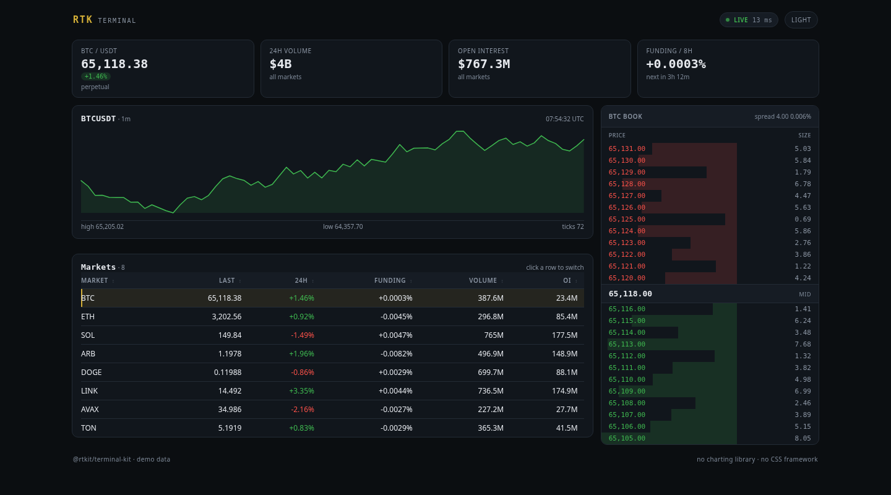

# Realtime Kit

[](https://github.com/jefo/realtime-kit/actions/workflows/ci.yml)
[](LICENSE)

Small, tested building blocks for real-time market terminals: normalized
exchange ingest, multiplexed SSE sessions, a UDF datafeed, and Svelte UI
primitives. Framework-agnostic where it matters, no vendor charting library.



## Status

**0.1 alpha.** The code is tested and the packages build, but the npm name and
scope will be finalized before the first publish. The API may change in 0.x.

Not on npm yet. Install from source:

```bash
git clone https://github.com/jefo/realtime-kit
cd realtime-kit
bun install
bun test
bun run test:ui
```

## What is inside

| Package | What it does |
|---|---|
| [`@rtkit/market-ingest`](packages/market-ingest) | Normalizes exchange events (`quote`, `kline`, `funding`, `liquidation`), reference-counts upstream subscriptions, caches the latest value. Binance connector included. |
| [`@rtkit/subscriptions`](packages/rt-subscriptions) | One SSE stream per session, deterministic subscription keys, bounded queues, first/last subscriber lifecycle hooks, typed client with reconnect. |
| [`@rtkit/udf-datafeed`](packages/udf-datafeed) | UDF server for TradingView-compatible charts: `config`, `symbols`, `history`, `time`, `search`, `quotes`. Bring your own `DataProvider`. |
| [`@rtkit/terminal-kit`](packages/terminal-kit) | Svelte 5 components for dense terminals: table, order book, sparkline, metric, connection badge, theme tokens. |

Each package is independently usable. There are no runtime dependencies between
them.

## Why

Most real-time dashboards start with one stream per widget and end with duplicate
subscriptions, reconnect storms and a slow consumer that grows memory. These
packages encode the parts that are hard to get right:

- fan-out and multiplexing instead of duplicate upstream connections;
- bounded queues with an explicit overflow policy;
- upstream lifecycle tied to subscriber count;
- a datafeed contract for charts without a vendor library;
- UI primitives that do not pull in a CSS framework or a charting library.

## Demos

```bash
bun run example:udf       # candlestick chart on in-memory data, localhost:8585
bun run example:bridge    # Binance WS -> normalized events -> SSE, localhost:8790
bun run example:terminal  # Svelte terminal dashboard, localhost:5190
```

The terminal demo uses mock data and has no backend. A hosted version:
<https://jefo.github.io/realtime-kit/> (deployed by the Pages workflow after the
first push to `main`).

## Prior art

This is not a replacement for the tools below; it is a different layer.

- **ccxt / cryptofeed** unify exchange APIs. This repo normalizes events for
  transport and UI; a ccxt connector could feed `MarketHub`.
- **better-sse / eventsource** provide SSE plumbing. `@rtkit/subscriptions` adds
  sessions, refcounting, bounded queues and lifecycle hooks.
- **lightweight-charts / TradingView** render charts. `@rtkit/udf-datafeed` is a
  datafeed for UDF-compatible charts; pair it with the chart library you prefer.
- **terminal-kit** (the npm package by cronvel) is a terminal-emulator UI
  library, unrelated to this project. The final project name will avoid that
  collision.

## Limitations

Honest list for a 0.1:

- Binance is the only bundled exchange connector; the interfaces are ready for
  more.
- Subscriptions are exact-match; no wildcards or patterns.
- SSE is at-most-once; there is no replay buffer or `Last-Event-ID` replay.
- Authentication and billing are your responsibility. Session IDs are bearer
  capabilities.
- `DataTable` does not virtualize; it is suitable for hundreds, not tens of
  thousands of rows without a controlled/manual mode.
- No candlestick chart component; `Sparkline` is the only chart primitive.
- SSR is not covered by tests yet.
- The API may change in 0.x.

## Security

- CORS is disabled by default in both HTTP handlers; opt in with `cors: true` or
  an explicit origin.
- `POST /subscribe` has a request body limit (64 KiB by default).
- Put the gateway behind authentication and a proxy; do not expose it as an open
  proxy to exchange APIs.
- Report vulnerabilities via [SECURITY.md](SECURITY.md), not a public issue.

## Contributing

See [CONTRIBUTING.md](CONTRIBUTING.md) and
[CODE_OF_CONDUCT.md](CODE_OF_CONDUCT.md). Bug reports and API feedback are
welcome; this is an early project and the discussion is the point.

More docs: [architecture](docs/architecture.md) · [roadmap](ROADMAP.md) ·
[release process](RELEASE.md).

## License

MIT. See [LICENSE](LICENSE). Not affiliated with TradingView or Binance.
