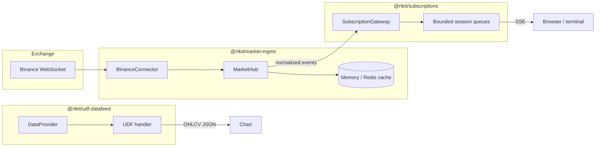
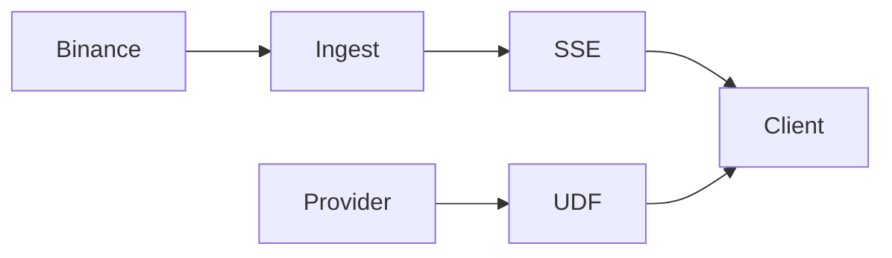
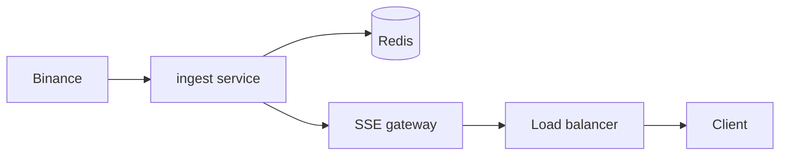

# Architecture

Three independent packages, one data path. Each can be used alone.

## Boundaries

### `@rtkit/market-ingest`

Knows about exchanges, not about HTTP or UI.

- `ExchangeConnector` owns the socket and maps payloads to `MarketEvent`.
- `MarketHub` reference-counts subscriptions, caches the last event per key and
  fans out to listeners/streams.
- No SSE, no auth, no framework.

**Failure modes:** socket drop → reconnect with backoff and resubscribe; slow
consumer → bounded queue; upstream error → `MarketError` with a code.

### `@rtkit/subscriptions`

Knows about sessions and streams, not about markets.

- `SubscriptionGateway` owns sessions, exact-match keys, queues and lifecycle
  hooks.
- `createSubscriptionsHandler` exposes `POST /subscribe`, `GET /events/:id`,
  `DELETE /sessions/:id`, `GET /health`.
- The client owns reconnect and session re-creation.

**Failure modes:** slow client → drop-oldest or disconnect; detached client →
TTL grace; hook failure → session rollback.

### `@rtkit/udf-datafeed`

Knows about the UDF protocol, not about sockets or sessions.

- `DataProvider` is the only integration point (`resolveSymbol`, `getBars`,
  optional search/quotes).
- The handler owns validation, timeouts, normalization and response shapes.

**Failure modes:** provider timeout → 504 + `s:"error"`; empty data →
`s:"no_data"`; unknown symbol → 404.

## Deployment topologies

### Single process (demo, small product)

One Bun process. In-memory cache. Good up to a few hundred concurrent streams.

### Split services

- `ingest` is a singleton per exchange; it publishes through Redis pub/sub or a
  queue.
- `gateway` is stateless per connection; scale horizontally.
- The cache is shared (Redis) so `latest()` works across instances.

### Chart service

The UDF handler is stateless and read-only. Put it behind a CDN/proxy with a
short cache for `history`, and keep the provider's rate limits in mind.

## Scaling notes

- Subscription keys are exact-match; do not subscribe to all symbols unless the
  exchange stream supports it.
- `maxQueuePerStream` / `maxQueuePerSession` bound memory per consumer.
- Binance public endpoints are rate-limited per IP: cache `exchangeInfo`, batch
  quotes, avoid one request per symbol.
- Session IDs are capabilities: terminate TLS, authenticate, use short TTLs.

## Testing strategy

- Protocol boundaries, not markup: canonical keys, UDF response shapes,
  normalization, reconnect, overflow.
- Adapters are tested with fake sockets/fetch; live checks are examples, not
  the test suite.
- Deterministic providers (`MemoryProvider`, `MemoryEventCache`) make demos and
  CI independent of the network.

## What is intentionally missing

- No charting library (UDF is the contract).
- No exchange SDK.
- No Redis dependency (interface only).
- No auth/billing (belongs to the product).
