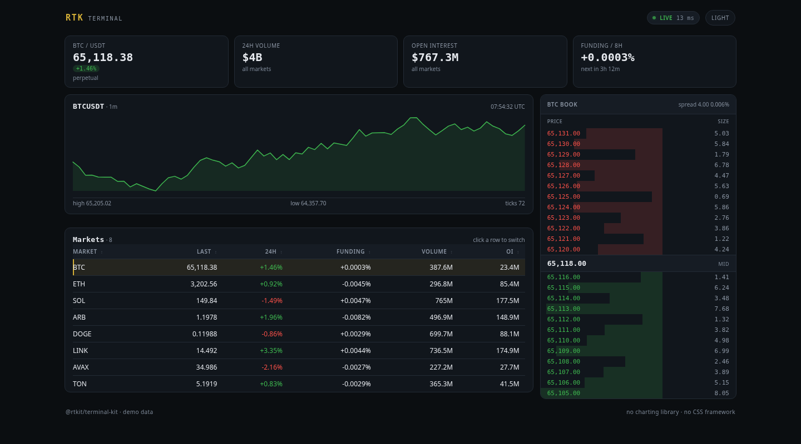

# @rtkit/terminal-kit

> Part of [Realtime Kit](https://github.com/jefo/realtime-kit) — small, tested
> building blocks for real-time market terminals.

**The UI layer of a trading terminal, without a charting library or a CSS
framework.**



Six Svelte 5 components and a set of pure primitives for the screens that are
expensive to get right: dense tables, an order book, sparklines, metrics and a
connection state. Dark and light themes, compact and comfortable density. Svelte
is a peer dependency; there are no other runtime dependencies.

- **No CSS framework.** Plain CSS with tokens you can override.
- **No charting library.** `Sparkline` is SVG; bring your own candlestick chart.
- **SSR-friendly.** No `window` at module scope. SSR rendering is not yet covered
  by tests.
- **Semantic markup.** Native table for the order book, `aria-sort`, keyboard row
  activation. Accessibility is being hardened; see the root limitations.
- **Typed.** Svelte 5 runes and exported TypeScript types.

## Install

Not on npm yet; the package name and scope will be finalized before the first
publish.

```bash
git clone https://github.com/jefo/realtime-kit
cd realtime-kit
bun install
```

`@rtkit/terminal-kit` requires `svelte@5` as a peer dependency. For a local
consumer, run `bun link` from `packages/terminal-kit`.

## Quick start

```svelte
<script lang="ts">
  import {
    ThemeProvider, DataTable, OrderBook, Metric, ConnectionBadge,
    formatPrice, formatPercent, type Column,
  } from "@rtkit/terminal-kit";

  const rows = [
    { symbol: "BTC", price: 65000, change: 1.24 },
    { symbol: "ETH", price: 3200, change: -0.82 },
  ];

  const columns: Column<(typeof rows)[number]>[] = [
    { key: "symbol", header: "Market" },
    { key: "price", header: "Last", align: "right", format: (v) => formatPrice(Number(v)) },
    {
      key: "change",
      header: "24h",
      align: "right",
      format: (v) => formatPercent(Number(v)),
      cellClass: (v) => (Number(v) >= 0 ? "up" : "down"),
    },
  ];
</script>

<ThemeProvider theme="dark" density="compact">
  <ConnectionBadge status="live" latencyMs={18} />
  <Metric label="BTC / USDT" value={65000} delta={1.24} decimals={2} />
  <DataTable {rows} {columns} rowKey={(row) => row.symbol} />
</ThemeProvider>
```

## Components

| Component | What it does |
|---|---|
| `ThemeProvider` | CSS tokens, dark/light, density, accent override |
| `DataTable` | typed columns, sorting, sticky header, selection, row click |
| `OrderBook` | bids/asks, depth bars, spread, tick aggregation |
| `Sparkline` | SVG line/area, fixed height, responsive width |
| `Metric` | label, value, signed delta, trend color |
| `ConnectionBadge` | live / connecting / reconnecting / offline, latency |

### DataTable

- Click a sortable header to cycle **asc → desc → unsorted**.
- `null`/`undefined` values are always sorted to the bottom.
- Sorting is stable and uses a custom `value` accessor when provided.
- `cellClass` colors a cell from its value; `cell` accepts a Svelte snippet
  when text formatting is not enough.
- `rowKey` is strongly recommended: it keeps selection and keyed rows stable
  when the order changes.
- For server-side sorting, pass `sort` + `onSortChange` and set `manualSort` so
  the component does not re-sort the rows it receives.

### OrderBook

- Bids are sorted descending, asks ascending; `maxRows` caps each side.
- Depth bars are scaled to the largest level.
- `tickSize` aggregates levels (bids round down, asks round up), so the spread
  never collapses.
- The mid price and spread are derived, not passed in.

### Sparkline

- Accepts a plain `number[]`; fixed `height`, responsive width.
- `min`/`max` can pin the scale; otherwise it auto-scales.
- Flat series and missing data render a dashed baseline instead of NaN paths.

## Theming

Everything is a CSS variable on `.rtk-root`:

```css
--rtk-bg, --rtk-panel, --rtk-panel-2, --rtk-panel-3
--rtk-border, --rtk-border-strong
--rtk-text, --rtk-muted, --rtk-faint
--rtk-up, --rtk-down, --rtk-accent
--rtk-up-soft, --rtk-down-soft, --rtk-accent-soft
--rtk-font, --rtk-mono, --rtk-font-size
--rtk-row-pad, --rtk-radius
```

`ThemeProvider` sets them for its subtree. Components used outside it fall back
to dark-theme defaults, so they never render unstyled.

```svelte
<ThemeProvider theme="light" density="comfortable" accent="#2563eb">
  ...
</ThemeProvider>
```

## Utilities

Pure functions, importable without Svelte:

- `formatPrice`, `formatSize`, `formatCompact`, `formatPercent`,
  `formatSigned`, `formatInteger`, `formatTime`, `formatDuration`,
  `formatDelta`.
- `sortRows`, `nextSortState`, `compareValues`, `ariaSort`.
- `sortLevels`, `aggregateLevels`, `spread`, `maxLevelSize`, `depthRatio`,
  `totalSize`.

## Demo

The repository includes a runnable terminal dashboard:

```bash
git clone https://github.com/jefo/realtime-kit
cd realtime-kit
bun install
bun run example:terminal
# http://localhost:5190
```

It uses mock data only: metric cards, sparkline, order book, sortable markets
table, theme toggle. No exchange keys, no network.

## Tests

```bash
bun test          # 30 unit tests: formatters, sorting, order book math
bun run test:ui   # 14 component tests (Vitest + Testing Library + jsdom)
bun run check     # svelte-check: components and types
bun run build     # svelte-package: dist + .d.ts
```

## Limitations

- `DataTable` does not virtualize; use `manualSort` and pagination for large
  datasets.
- No candlestick chart; `Sparkline` is intentionally minimal.
- SSR is not covered by tests yet.
- Accessibility is semantic but still being audited (ARIA, contrast, focus).

## Roadmap

- Virtualized `DataTable` for 10k+ rows.
- Canvas `DepthChart` and liquidation heatmap.
- Trades tape with aggregation.
- Timeframe switcher and chart shell (bring `lightweight-charts`).
- Storybook-style playground.

## License

MIT
